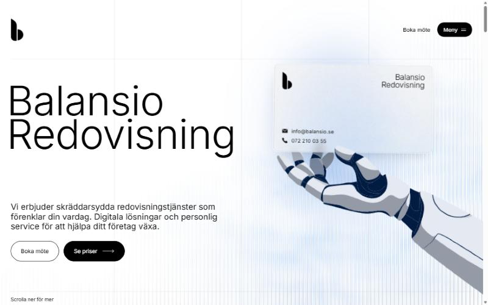
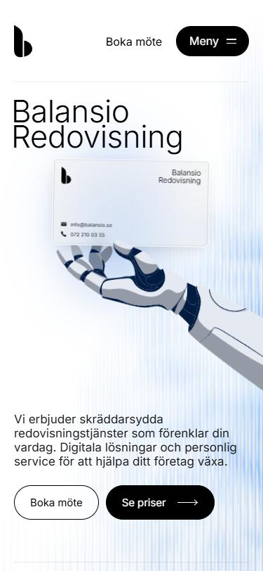
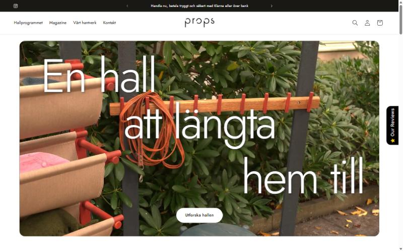
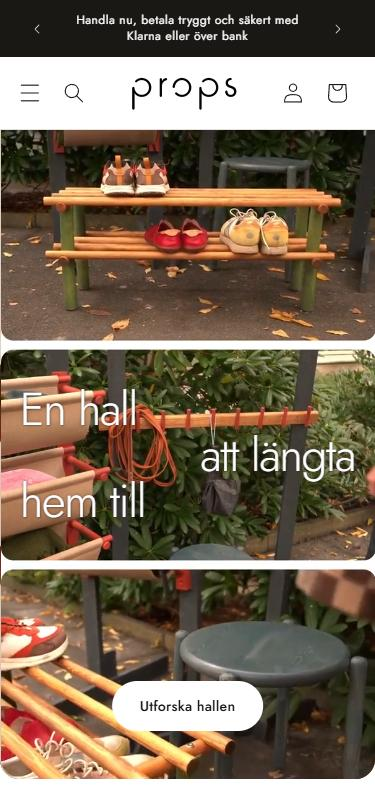
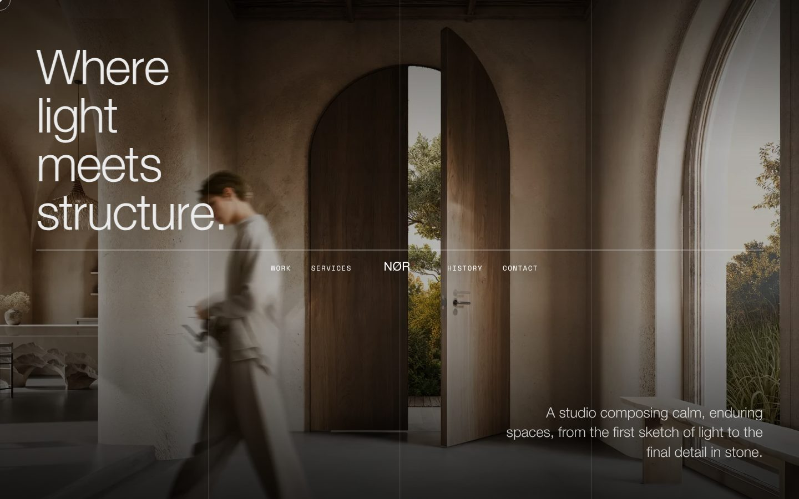
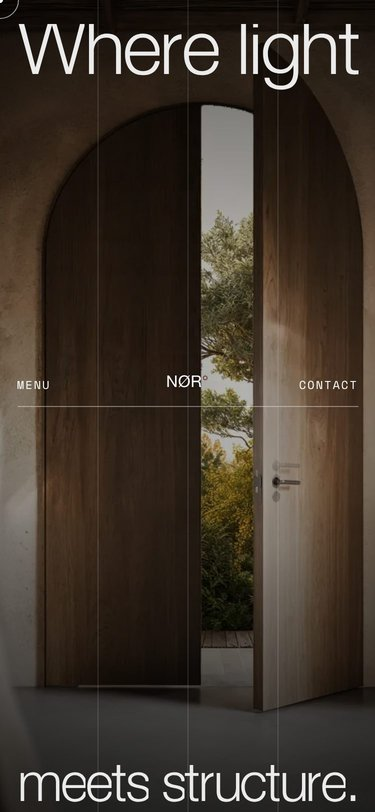

# Adam Khalil · Frontend

I build websites with Vue, motion and WebGL, from design to deploy. I'm a co-owner of Caowl Studios, a web studio in Stockholm.

Most of the source code lives in private repos, so this page shows screenshots, live links and notes on what I built and why. The code for NØR is public.

| Project | What it is | My part | Link |
| --- | --- | --- | --- |
| [Balansio Redovisning](#balansio-redovisning) | Website for an accounting firm | Everything | [balansio.se](https://balansio.se) |
| [Props Möbler](#props-möbler) | Shopify store redesign for a furniture maker | Everything | [propshome.se](https://propshome.se) |
| [NØR](#nør) | Concept site for an architecture studio | Everything | [Live site](https://adamk1979.github.io/nor-concept/) |
| [Balansio Connect](#balansio-connect) | Fortnox integration that registers supplier invoices | Everything | Internal tool |
| [Caowl Studios](#caowl-studios) | Our studio website | Shared with the team | [caowlstudios.com](https://www.caowlstudios.com) |

---

## Balansio Redovisning

**Live:** [balansio.se](https://balansio.se)

  
  &nbsp;
  

Website for an accounting firm in Stockholm. I did the whole project myself: design, frontend, animation and deployment.

### What I built

- A Vue 3 single-page app built with Vite, with one component per section and scoped styles
- A hero background drawn by a custom fragment shader on WebGL2
- Scroll-driven animation with GSAP and ScrollTrigger, and smooth scrolling with Lenis
- A drawer navigation built from scratch, which turns off its motion when the user has `prefers-reduced-motion` set
- A layout that works from 375 px phones up to wide desktop screens
- Self-hosted Inter Variable font, so no requests go to a third-party font service

### Decision: OGL instead of Three.js for the shader

The hero background is one full-screen plane with a fragment shader on it. Three.js would have worked, but its scene graph, materials and loaders would mostly go unused for a single plane. I used [OGL](https://github.com/oframe/ogl) instead, a small WebGL library that gives me the renderer and the shader program without the rest.

A shader that runs all the time drains battery on phones, so the render loop only runs when it's needed:

- It stops when the hero scrolls out of view (`IntersectionObserver`)
- It stops when the browser tab is hidden (`visibilitychange`)
- The device pixel ratio is capped, so high-density screens don't render more pixels than the effect needs

**Stack:** Vue 3, Vue Router, Vite, OGL (WebGL2), GLSL, GSAP, ScrollTrigger, Lenis, scoped CSS. Static build hosted on one.com.

---

## Props Möbler

**Live:** [propshome.se](https://propshome.se)

  
  &nbsp;
  

Redesign of the Shopify store for Props, a Swedish furniture maker. I did the full redesign: the theme code, the layout and the release setup.

### What I built

- A new look for the whole store, built on Shopify's Dawn theme with my own sections, snippets and CSS
- A video hero that runs wide on desktop and splits into stacked panels on phones
- A staging theme on the real store, so every change can be checked on a live storefront before it's published
- A GitHub Actions workflow that runs Shopify Theme Check on every pull request

### Decision: rebuild the look on Dawn instead of buying a premium theme

The design took its cues from Impact, a paid Shopify theme. Instead of buying it, I rebuilt the parts we needed on top of Dawn, Shopify's free reference theme. That kept the store on a theme Shopify maintains and updates, kept the code small, and meant I knew every line in it when the client asked for changes later.

I also chose not to connect Shopify's GitHub integration yet. It syncs both ways and can't be turned off, so the store owner's edits in the theme editor would be committed into the repo mixed in with code changes. Deploys go through the Shopify CLI to the staging theme instead.

**Stack:** Shopify Liquid, Dawn (Online Store 2.0), JavaScript, CSS, Shopify CLI, Theme Check, GitHub Actions.

---

## NØR

**Live:** [adamk1979.github.io/nor-concept](https://adamk1979.github.io/nor-concept/) · **Code:** [nor-concept](https://github.com/Adamk1979/nor-concept)

  
  &nbsp;
  

A one-page concept site for a fictional architecture studio, made for the Caowl Studios portfolio. I designed and built the whole page myself.

### What I built

- An intro loader where the grid columns collapse into the page
- A split-text headline that reveals over a vertical grid
- A "Selected work" carousel standing in 3D: it's pinned, and scrolling turns the ring so the card in front faces you
- A full-screen overlay menu for phones
- Smaller copies of every project photo served to phones through `<picture>`, with a small script that rebuilds them when the photos change

### Decision: no framework

The page is one long scroll with no routing, no forms and no data. A framework would only add a build step and a runtime, so it's plain HTML, CSS and JavaScript. GSAP and the fonts are stored in the repo instead of loaded from a CDN, so the page has no outside dependencies at runtime.

**Stack:** HTML, CSS, JavaScript, GSAP (ScrollTrigger, SplitText, CustomEase), Locomotive Scroll.

---

## Balansio Connect

An internal tool for Balansio Redovisning that reads supplier invoices from a client's Fortnox inbox and registers them in Fortnox for the accountant to review. Not frontend, but I designed and built all of it, and it's running with real clients.

### What I built

- A Node.js and TypeScript backend that talks to the Fortnox REST API
- Invoice reading from PDFs and scanned images, with pdf.js and Tesseract OCR
- Checks for amounts, VAT, supplier, recipient and duplicates before anything is written
- A server-rendered web interface with Google login, where the accountant sees each invoice and handles the ones that need a person
- A ChatGPT integration over MCP, so the accountant can check status and start runs from a chat
- About 2,200 tests, including a set of attack tests that try to trick the system into a wrong write
- Deployment with Docker and Coolify on a Hetzner server, with encrypted backups

### Decision: the tool can never book anything

The rule for the whole product is that no wrong value may ever reach a client's books. So the tool registers invoices **unbooked**, and the accountant books them in Fortnox after checking. Every Fortnox call goes through an allowlist of exact endpoints, and every write goes through a gate that checks the company, the mode and the fields being sent. Anything not on the list is refused before it leaves the server. When the tool is unsure, it stops and hands the invoice to a person instead of guessing.

**Stack:** TypeScript on Node.js 24, node:sqlite, node:test, Fortnox API, pdf.js, Tesseract.js, MCP, Docker, Coolify.

---

## Caowl Studios

**Live:** [caowlstudios.com](https://www.caowlstudios.com)

Our studio's own website, built together with the Caowl Studios team. There's a separate write-up here: [caowl-studios-showcase](https://github.com/Adamk1979/caowl-studios-showcase).
